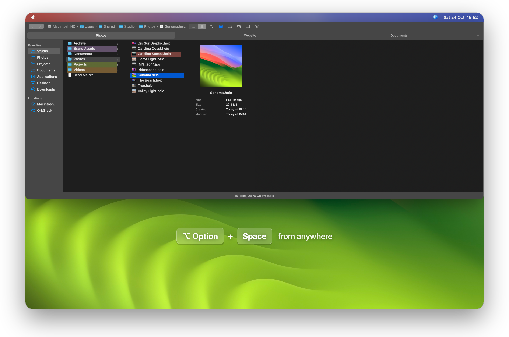
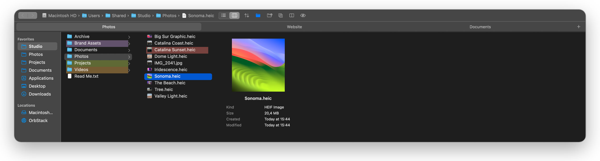
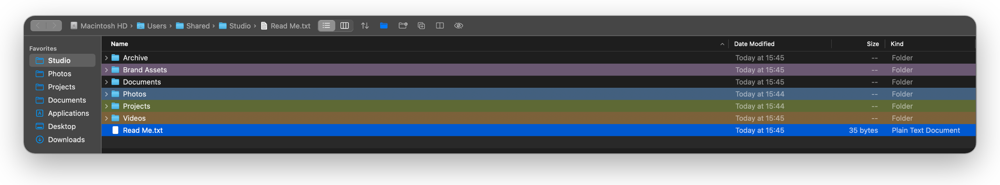
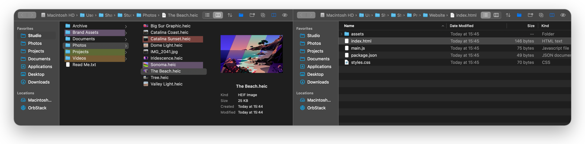

<div align="center">


# UltimateFinder

**A Finder visor for macOS.** Press <kbd>⌥</kbd> <kbd>Space</kbd> anywhere and a Finder-style browser slides down from the top of the screen. Press it again and it's gone.

[](https://github.com/mzogot/UltimateFinder/releases/latest)
[](https://github.com/mzogot/UltimateFinder/releases)


[](LICENSE)

[**⬇ Download for macOS**](https://github.com/mzogot/UltimateFinder/releases/latest/download/UltimateFinder.dmg) · [Features](#features) · [Shortcuts](#keyboard-shortcuts) · [Changelog](CHANGELOG.md)

<br>



</div>

## Why UltimateFinder

If you remember [TotalFinder](https://totalfinder.binaryage.com)'s visor, you know the idea: your file browser is always one keystroke away. UltimateFinder brings it back as a small, native app for current macOS.

- **Always one keystroke away.** No switching to the Dock or digging for the right Finder window. The visor appears on the display your mouse is on, takes the keyboard straight away, and gives focus back to the app you were using when it hides.
- **Works like Finder.** Same shortcuts, same drag-and-drop rules, tabs, back/forward history, Quick Look and color tags. You already know how to use it.
- **Adds what Finder lacks.** Split view for moving files between two folders, image conversion to JPEG, PNG or WebP, *Copy Name Without Extension*, folders on top in every sort order, *New Text File* and *Open in Terminal*.
- **Light and private.** Native Swift and AppKit, a 2 MB download, no Electron. No account, no telemetry, no network access at all.
- **Free and open source** under the MIT license.

## Features

### Column view with previews



Finder's column view, with an icon preview for each image, PDF and movie, and a preview column with the file's details. Columns update live when files change, and their widths are remembered.

### List view and color labels



A sortable list with Name, Date Modified, Size and Kind columns, disclosure triangles to expand folders in place, and columns you can drag and resize. Color labels tint the whole row, the way Finder's labels used to. They are Finder's own color tags, so Finder shows them too.

### Split view



Press <kbd>⌘</kbd> <kbd>U</kbd> for two browsers side by side, then drag files from one to the other, or cut on one side and paste on the other. Each side has its own sidebar, tabs, history and view mode.

### And everything else you'd expect

- **Tabs** like Finder's, restored after a relaunch, with back/forward history per tab.
- **Editable sidebar.** Drag folders in, reorder them, drop files onto a favorite, or import Finder's own favorites in one click. Drives and network volumes can be ejected from there.
- **Drag and drop** with the desktop, Finder or any app, following Finder's rules: same volume moves, another volume copies, <kbd>⌥</kbd> copies, <kbd>⌘</kbd> moves.
- **Convert Image:** right-click photos and save a JPEG, PNG or WebP copy of each. Rotation and EXIF/GPS data are kept, and originals are never touched.
- **Cut and paste** to move files (<kbd>⌘</kbd> <kbd>X</kbd>, then <kbd>⌘</kbd> <kbd>V</kbd>), including between the two sides of split view.
- **Quick Look** with <kbd>Space</kbd>; the arrow keys keep browsing while it's open.
- **Copy Name**, **Copy Name Without Extension** and **Copy Path**, for one item or several.
- **Keep Folders on Top** in every sort order and direction.
- **New Folder**, **New Text File**, **Duplicate**, **Rename**, **Move to Trash**, **Share**, **Open With** and **Open in Terminal**.
- **Hidden files** toggle, **Reveal in Finder**, and **Launch at Login**.
- **Mouse and trackpad:** back/forward mouse buttons and page swipes work as they do in Finder.

## Download and install

1. Download **[UltimateFinder.dmg](https://github.com/mzogot/UltimateFinder/releases/latest/download/UltimateFinder.dmg)** from the [latest release](https://github.com/mzogot/UltimateFinder/releases/latest).
2. Open it and drag **UltimateFinder** into **Applications**.
3. Launch it, then press <kbd>⌥</kbd> <kbd>Space</kbd>.

The app is signed with a Developer ID and notarized by Apple, so it opens without warnings. It's a universal app for Apple silicon and Intel Macs, and needs **macOS 13 Ventura or later**.

UltimateFinder lives in the menu bar, with no Dock icon. The menu-bar icon lets you change the shortcut (<kbd>⌥</kbd> <kbd>Space</kbd>, <kbd>⌥</kbd> <kbd>\`</kbd> or <kbd>⌃</kbd> <kbd>⌥</kbd> <kbd>Space</kbd>) and turn on *Launch at Login*. It also has *Hide When Focus Is Lost*, *Show Hidden Files* and *Split View*.

**Updating:** download the new version and replace the app in Applications. Your tabs, favorites and settings are kept.

**Uninstalling:** quit it from the menu-bar icon and move it to the Trash. To remove its settings too, run `defaults delete com.ultimatefinder.visor`.

## Keyboard shortcuts

| Action | Shortcut |
|---|---|
| Show / hide the visor | <kbd>⌥</kbd> <kbd>Space</kbd> (configurable), <kbd>Esc</kbd> or <kbd>⌘</kbd> <kbd>W</kbd> to hide |
| Quick Look | <kbd>Space</kbd> or <kbd>⌘</kbd> <kbd>Y</kbd> |
| Open | double-click, <kbd>⌘</kbd> <kbd>O</kbd> or <kbd>⌘</kbd> <kbd>↓</kbd> |
| Back / forward | <kbd>⌘</kbd> <kbd>[</kbd> / <kbd>⌘</kbd> <kbd>]</kbd>, mouse buttons 4 / 5, or swipe |
| Parent folder | <kbd>⌘</kbd> <kbd>↑</kbd> |
| Rename | <kbd>Return</kbd> |
| New folder | <kbd>⇧</kbd> <kbd>⌘</kbd> <kbd>N</kbd> |
| Cut / copy / paste | <kbd>⌘</kbd> <kbd>X</kbd> / <kbd>⌘</kbd> <kbd>C</kbd> / <kbd>⌘</kbd> <kbd>V</kbd> |
| Move here | <kbd>⌥</kbd> <kbd>⌘</kbd> <kbd>V</kbd> |
| Copy path | <kbd>⌥</kbd> <kbd>⌘</kbd> <kbd>C</kbd> |
| Duplicate | <kbd>⌘</kbd> <kbd>D</kbd> |
| Move to Trash | <kbd>⌘</kbd> <kbd>⌫</kbd> |
| Reveal in Finder | <kbd>⌘</kbd> <kbd>R</kbd> |
| Show hidden files | <kbd>⇧</kbd> <kbd>⌘</kbd> <kbd>.</kbd> |
| Split view | <kbd>⌘</kbd> <kbd>U</kbd> |
| List / column view | <kbd>⌘</kbd> <kbd>2</kbd> / <kbd>⌘</kbd> <kbd>3</kbd> |
| New tab / close tab | <kbd>⌘</kbd> <kbd>T</kbd> / <kbd>⌘</kbd> <kbd>W</kbd> |
| Next / previous tab | <kbd>⌃</kbd> <kbd>Tab</kbd> / <kbd>⌃</kbd> <kbd>⇧</kbd> <kbd>Tab</kbd>, or <kbd>⇧</kbd> <kbd>⌘</kbd> <kbd>]</kbd> / <kbd>⇧</kbd> <kbd>⌘</kbd> <kbd>[</kbd> |
| Open folder in new tab | <kbd>⌘</kbd>-double-click |
| Add folder to sidebar | <kbd>⌃</kbd> <kbd>⌘</kbd> <kbd>T</kbd> |

On a German keyboard, <kbd>⌘</kbd> <kbd>[</kbd> / <kbd>⌘</kbd> <kbd>]</kbd> are <kbd>⌘</kbd> <kbd>Ü</kbd> / <kbd>⌘</kbd> <kbd>+</kbd>, as in Finder.

<details>
<summary><b>Full feature reference</b></summary>

- **Right-click** an item or empty space for: Open, Open in New Tab, Open With, Quick Look, Show in Finder, Cut, Copy, Copy Name, Copy Name Without Extension, Copy Path, Add to Sidebar, Duplicate, Convert Image, Rename, Move to Trash, color labels, Share, New Folder, New Text File, Paste and Open in Terminal.
- **Split view** shows two browsers side by side, 50/50. Each side has its own sidebar, tabs, history and list/column view (all remembered); sort order, hidden files and favorites are shared. Keys act on the side you last clicked in. Drag the divider to resize; the proportion is kept across displays.
- **Cut** marks items to be moved: the next Paste moves them instead of copying, even into the other side of split view. Copying anything else first cancels the cut. Holding <kbd>⌥</kbd> in the right-click menu turns *Paste* into *Move Items Here*.
- **New Text File** creates a blank `untitled.rtf` (opens in TextEdit) and asks for its name, like New Folder.
- **Convert Image** (shown when only images are selected) saves a JPEG, PNG or WebP copy next to each original; existing files are never overwritten (`photo 2.png`). Rotation from the camera is applied, EXIF/GPS metadata is kept for JPEG and PNG, and transparency turns white in JPEG. WebP is lossy (quality 90) from JPEG/HEIC photos and lossless otherwise.
- **List view** works like Finder's: click a header to sort by it (click again to reverse), drag headers to reorder or resize them, use the disclosure triangles (or <kbd>→</kbd> / <kbd>←</kbd>) to expand folders in place. The sort order is shared with column view, where the sort button picks it.
- **Back / forward** history is kept per tab. A step is recorded whenever the folder you're looking into changes, and going back also restores what was selected there.
- **Tabs** appear once you have two or more. Each is titled after the folder you're looking into; middle-click closes one. Tabs and their selection are restored when the visor reopens and after relaunching.
- **Favorites** in the sidebar: drag folders *between* rows to add them and drag favorites to reorder; drop files *onto* a favorite to move or copy them there; right-click for *Open in New Tab*, *Show in Finder* or *Remove from Sidebar* (or press <kbd>Delete</kbd>); right-click empty sidebar space for *Import Finder Favorites…* or *Restore Default Favorites*.
- **Selecting with the mouse:** pressing on an item's icon or name and dragging drags the item; pressing beside the name and dragging selects every row the mouse passes over.
- **Icon previews** load in the background; the file-type icon shows until each thumbnail is ready.
- **Color labels** are stored as Finder's color tags (Red, Orange, Yellow, Green, Blue, Purple, Gray). Other tags on the item are kept. Click the current color again to remove it.
- **Placement:** the visor spans the full width of the display with the mouse and the top 60% of its height, just under the menu bar.
- **Launching** the app again while it runs (from Spotlight, say) toggles the visor. `open -a UltimateFinder --args --show` shows it on launch.

</details>

## Privacy and permissions

UltimateFinder makes **no network connections**: no analytics, no update checks, no account. Your settings stay in `~/Library/Preferences/com.ultimatefinder.visor.plist`.

| Permission | When it's asked | Why |
|---|---|---|
| Desktop, Documents, Downloads, removable and network volumes | The first time you open one of them | macOS asks before any app reads these folders. Folders are only watched while they're on screen, and favorites are stored as plain paths, so you're never asked about a folder you didn't open. |
| Accessibility | Only if another app already owns your shortcut | The shortcut normally uses Carbon's `RegisterEventHotKey`, which needs no permission. If that combination is taken, UltimateFinder explains why and offers to open System Settings, or you can pick another shortcut. |

## Build from source

No Xcode needed; the Command Line Tools (`xcode-select --install`) are enough.

```sh
git clone https://github.com/mzogot/UltimateFinder.git
cd UltimateFinder
./build.sh install    # build, copy to /Applications, launch
```

`./build.sh` alone builds `build/UltimateFinder.app`, and `./build.sh run` launches it from there. The first build fetches [libwebp](https://github.com/SDWebImage/libwebp-Xcode), so it needs network access. `build.sh` signs with your *Developer ID* or *Apple Development* certificate if you have one, otherwise ad hoc. An ad-hoc build works, but macOS asks for folder access again after every rebuild.

See [docs/DEVELOPMENT.md](docs/DEVELOPMENT.md) for the project layout, the release process and implementation notes.

## Contributing

Bug reports and feature ideas are welcome in [Issues](https://github.com/mzogot/UltimateFinder/issues). For code changes, read [CONTRIBUTING.md](CONTRIBUTING.md) first.

## Credits

Inspired by the visor in [TotalFinder](https://totalfinder.binaryage.com) by BinaryAge. UltimateFinder is an independent project, not affiliated with BinaryAge or Apple. It uses [libwebp](https://chromium.googlesource.com/webm/libwebp) to write WebP files; see [THIRD_PARTY_NOTICES.md](THIRD_PARTY_NOTICES.md).

## License

[MIT](LICENSE) © 2026 Michael Zogot
